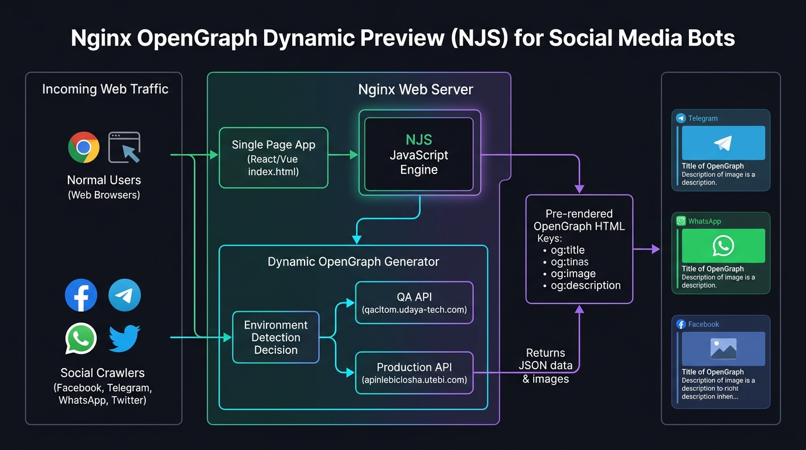
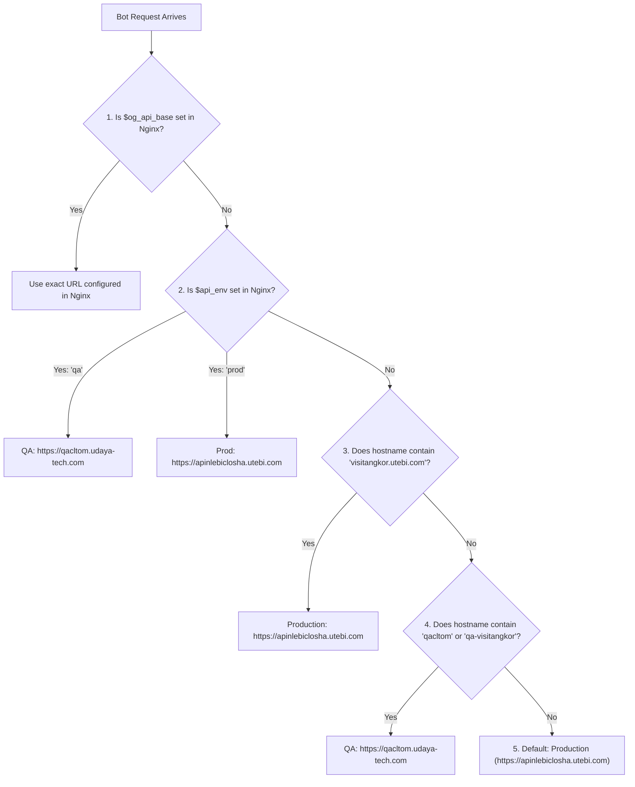

# 🚀 Standalone Nginx OpenGraph Dynamic Preview (NJS)

A complete, production-ready, standalone package for serving dynamic **OpenGraph (og:*)** and **Twitter Card** preview tags to social media crawlers (Facebook, Telegram, WhatsApp, Twitter, LinkedIn, etc.) on real Linux servers running standard Nginx (without Docker) and on Docker gateways.

---

## 📑 Table of Contents
1. [How It Works (Architecture)](#-how-it-works-architecture)
2. [Package File Structure](#-package-file-structure)
3. [Environment Detection (QA vs Production)](#-environment-detection-qa-vs-production)
4. [Supported Pages & API Mapping](#-supported-pages--api-mapping)
5. [Automated Installation (Recommended)](#-automated-installation-recommended)
6. [Manual Installation Guide](#-manual-installation-guide)
7. [Nginx Configuration Examples](#-nginx-configuration-examples)
8. [Testing & Verification](#-testing--verification)
9. [Troubleshooting & FAQ](#-troubleshooting--faq)

---

## 🧠 How It Works (Architecture)

Single Page Applications (React, Vue, Angular) render in the client's browser. However, social media crawlers (Facebook crawler, TelegramBot, WhatsApp, etc.) **do not execute JavaScript**. When a user shares a link, the crawler only parses the static raw HTML response.

This package uses **Nginx NJS (ngx_http_js_module)** to detect bot user agents and return pre-rendered HTML cards containing dynamic meta tags, while normal users continue straight to the client-side SPA.



```
                              ┌──────────────────────────────────────────────┐
                              │                 User Request                 │
                              └──────────────────────┬───────────────────────┘
                                                     │
                                                     ▼
                                      ┌──────────────────────────────┐
                                      │    Nginx (Detects Crawler)   │
                                      └──────┬────────────────┬──────┘
                                             │                │
                        Crawler = 1 (Bot)    │                │  Normal User (Browser)
                                             ▼                ▼
┌────────────────────────────────────────────────────────┐  ┌────────────────────────────────────────────────┐
│  Nginx NJS (og_preview.js)                             │  │  Static Files (try_files)                      │
│  1. Extract ID from URL (/temple/detail/111)           │  │  1. Serve index.html                           │
│  2. Fetch dynamic JSON & images from Backend API       │  │  2. React/Vue SPA mounts normally              │
│  3. Return lightweight HTML with <meta property="og:*">│  │  3. Full interactive application               │
└────────────────────────────────────────────────────────┘  └────────────────────────────────────────────────┘
```

> [!NOTE]
> The generated bot preview HTML also includes `<script>window.location.href = "...";</script>`. If a human user opens the preview URL by mistake, their browser immediately redirects to the real SPA page seamlessly.

---

## 📁 Package File Structure

```text
nginx-og-preview/
├── DEPLOY_MANUAL.txt          # Plain-text quick deployment manual for your team
├── architecture-flowchart.jpg # Visual architectural flowchart diagram
├── og_preview.js              # NJS module: extracts URL params, calls backend API, builds meta tags
├── og-preview.conf            # Modular drop-in Nginx configuration snippet
├── robots.txt                 # Permissive robots.txt allowing facebookexternalhit
├── install.sh                 # Automated 1-step installer for Debian/Ubuntu and RHEL/CentOS
├── test-bot.sh                # Interactive CLI testing tool simulating social media bots
└── README.md                  # Comprehensive documentation & setup instructions
```

---

## 🔍 Environment Detection (QA vs Production)

The module dynamically determines whether to call the **Production API** or the **QA API** using a 4-tier cascading resolution strategy:

| Priority | Detection Rule | Target API |
| :--- | :--- | :--- |
| **1. Explicit Variable** | `$og_api_base` defined in `server { ... }` | Exact value configured |
| **2. Environment Flag** | `$api_env "qa"` or `$api_env "production"` | QA or Production accordingly |
| **3. Explicit Production Domain** | Domain contains `visitangkor.utebi.com` | **Production: `https://apinlebiclosha.utebi.com`** |
| **4. Hostname Matching (QA)** | Domain contains `qacltom` or `qa-visitangkor` | QA: `https://qacltom.udaya-tech.com` |
| **5. Default (Fallback)**| Any other domain (e.g. `local-app`) | **Production: `https://apinlebiclosha.utebi.com`** |

### Decision Flowchart



### Environment Scenarios

* **Real Production Server (`https://visitangkor.utebi.com`)**:
  * Your live production domain.
  * **Result:** Automatically queries **Production API** (`https://apinlebiclosha.utebi.com`).
* **Docker Gateway (`local-app.tail7fda6b.ts.net`)**:
  * Hostname does not match `qacltom` or `qa-visitangkor`.
  * **Result:** Automatically queries **Production API** (`https://apinlebiclosha.utebi.com`).
* **Real QA Server (`https://qa-visitangkor.udaya-tech.com` or `https://qacltom...`)**:
  * Domain matches `qa-visitangkor` / `qacltom`.
  * **Result:** Automatically queries **QA API** (`https://qacltom.udaya-tech.com`).

---

## 🗺️ Supported Pages & API Mapping

The script automatically parses URLs and queries the corresponding backend endpoint:

| Page Type | Frontend URL Pattern | Backend API Endpoint Called | Metadata Extracted |
| :--- | :--- | :--- | :--- |
| **Temples** | `/temple/detail/:id` | `POST /visitAngkorMobileAPi/temple/find/:id` | Khmer title (`nameKh`), thumbnail (`thumbnail`/`slide`), history text (`historyKh`) |
| **Activities** | `/activity/detail/:id` | `POST /visitAngkorMobileAPi/more-than-temple-type/find-item/activity/:id` | Name (`nameKh`/`nameEn`), photo, description |
| **Events** | `/event/detail/:id` | `POST /visitAngkorMobileAPi/more-than-temple-type/find-item/event/:id` | Event name, banner image, event details |
| **Annual Events** | `/annual_event/detail/:id` | `POST /visitAngkorMobileAPi/more-than-temple-type/find-item/annual_event/:id` | Annual event name, poster, description |
| **Communities** | `/community/detail/:id` | `POST /visitAngkorMobileAPi/more-than-temple-type/find-item/community/:id` | Community name, thumbnail, intro |
| **Museums** | `/museum/detail/:id` | `POST /visitAngkorMobileAPi/more-than-temple-type/find-item/museum/:id` | Museum name, image, description |
| **Other** | `/other/detail/:id` | `POST /visitAngkorMobileAPi/more-than-temple-type/find-item/other/:id` | Item title, thumbnail, description |
| **Audio Guide** | `/audio/:nanoId` | `POST /visitAngkorMobileAPi/museum/public/audio-guide/:nanoId` | Audio guide title (`name`), cover image (`imageUrl`) |

> [!TIP]
> Both root paths (e.g. `/temple/detail/111`) and prefixed paths (e.g. `/visit-angkor/temple/detail/111`) are automatically supported.

---

## ⚡ Automated Installation (Recommended)

Use the automated installer to set up NJS and the script on your server in seconds:

1. **Upload `nginx-og-preview` to your real server:**
   ```bash
   scp -r nginx-og-preview user@your-server-ip:/tmp/
   ```

2. **Run the installer as root/sudo:**
   ```bash
   ssh user@your-server-ip
   cd /tmp/nginx-og-preview
   sudo bash install.sh
   ```

The script will:
* Detect your OS package manager (`apt` or `dnf`/`yum`).
* Install `libnginx-mod-http-js` or `nginx-module-njs`.
* Copy `og_preview.js` to `/etc/nginx/og_preview.js` with proper permissions (`chmod 644`).
* Check if module loading is required in `/etc/nginx/nginx.conf`.
* Validate configuration syntax with `nginx -t`.

---

## 🛠️ Manual Installation Guide

If you prefer installing manually or are integrating into CI/CD / Ansible / Docker:

### Step 1: Install Nginx JavaScript Module (NJS)
* **Ubuntu / Debian:**
  ```bash
  sudo apt update
  sudo apt install -y libnginx-mod-http-js
  ```
* **CentOS / RHEL / AlmaLinux / Rocky:**
  ```bash
  sudo dnf install -y nginx-module-njs
  # On older CentOS 7: sudo yum install -y nginx-module-njs
  ```

### Step 2: Ensure Module is Loaded in `nginx.conf`
Open `/etc/nginx/nginx.conf` and ensure the module is loaded at the very top (in the main context, before `http {`):
```nginx
load_module modules/ngx_http_js_module.so;

events {
    worker_connections 1024;
}
http {
    ...
```

### Step 3: Copy Module File
```bash
sudo cp og_preview.js /etc/nginx/og_preview.js
sudo chmod 644 /etc/nginx/og_preview.js
```

---

## ⚙️ Nginx Configuration Examples

Add the following to your website's configuration file (e.g. `/etc/nginx/sites-available/your-site.conf` or `/etc/nginx/conf.d/default.conf`):

### Example 1: Standard SPA Deployment (Root URL)

```nginx
# 1. Import NJS module (Must be outside the server block, inside http context)
js_import og_preview from /etc/nginx/og_preview.js;

# 2. Map user agent to detect crawlers
map $http_user_agent $is_crawler {
    default 0;
    ~*(facebookexternalhit|telegrambot|whatsapp|twitterbot|linkedinbot|bingbot|googlebot|slackbot|discordbot|applebot) 1;
}

server {
    listen 80;
    listen 443 ssl http2;
    server_name visitangkor.utebi.com;

    root /var/www/html;
    index index.html;

    # 3. DNS Resolver (Mandatory for ngx.fetch outbound API calls)
    resolver 8.8.8.8 1.1.1.1 valid=30s;
    js_fetch_verify off;
    js_fetch_timeout 5s;

    # 4. Route bots visiting detail pages to NJS preview generator
    location / {
        if ($is_crawler = 1) {
            rewrite ^/(visit-angkor/)?(temple|activity|event|annual_event|community|museum|other|audio)/.*$ /_njs_bot_preview last;
        }
        try_files $uri $uri/ /index.html;
    }

    # 5. Internal NJS bot preview handler
    location = /_njs_bot_preview {
        internal;
        js_content og_preview.handleBotPreview;
    }
}
```

---

### Example 2: Explicitly Forcing QA or Production

If you want to explicitly pin an environment without relying on domain name detection:

```nginx
server {
    listen 443 ssl http2;
    server_name test-preview.utebi.com;

    # OPTION A: Set custom API URL directly
    set $og_api_base "https://qacltom.udaya-tech.com";

    # OPTION B: Or set the environment keyword
    # set $api_env "qa";          # Uses https://qacltom.udaya-tech.com
    # set $api_env "production";  # Uses https://apinlebiclosha.utebi.com

    ...
}
```

---

## 🧪 Testing & Verification

### 1. Test Using the Included CLI Script
The `test-bot.sh` script simulates actual crawlers and parses the output:

```bash
# Test Facebook crawler:
bash test-bot.sh https://visitangkor.utebi.com/temple/detail/111 facebook

# Test Telegram crawler:
bash test-bot.sh https://visitangkor.utebi.com/temple/detail/111 telegram

# Test WhatsApp crawler:
bash test-bot.sh https://visitangkor.utebi.com/temple/detail/111 whatsapp
```

### 2. Test Using Standard `curl`
```bash
curl -i -A "facebookexternalhit/1.1" https://visitangkor.utebi.com/temple/detail/111
```

#### Expected Response for Temple 111 (Preah Khan):
```html
HTTP/1.1 200 OK
Content-Type: text/html; charset=UTF-8

<!DOCTYPE html>
<html lang="en">
  <head>
    <meta charset="utf-8" />
    <title>ព្រះខ័ន | Visit Angkor</title>
    <meta name="description" content="ប្រាសាទព្រះខ័ន៖ ការទស្សនាចាប់ផ្តើមបើកម៉ោង០៦:០០ព្រឹក..." />
    <meta property="og:type" content="website" />
    <meta property="og:site_name" content="Apsara | Visit Angkor" />
    <meta property="og:locale" content="km_KH" />
    <meta property="og:title" content="ព្រះខ័ន | Visit Angkor" />
    <meta property="og:description" content="ប្រាសាទព្រះខ័ន៖ ការទស្សនាចាប់ផ្តើមបើកម៉ោង០៦:០០ព្រឹក..." />
    <meta property="og:url" content="https://yourdomain.com/temple/detail/111" />
    <meta property="og:image" content="https://apinlebiclosha.utebi.com/visitAngkorWebAPi/upload/0ae7aa64-b8e0-441a-8c6a-91dd3deca3ac.jpg" />
    <meta property="og:image:width" content="1200" />
    <meta property="og:image:height" content="630" />
    <meta name="twitter:card" content="summary_large_image" />
    <meta name="twitter:title" content="ព្រះខ័ន | Visit Angkor" />
    <meta name="twitter:description" content="ប្រាសាទព្រះខ័ន៖ ការទស្សនាចាប់ផ្តើមបើកម៉ោង០៦:០០ព្រឹក..." />
    <meta name="twitter:image" content="https://apinlebiclosha.utebi.com/visitAngkorWebAPi/upload/0ae7aa64-b8e0-441a-8c6a-91dd3deca3ac.jpg" />
  </head>
  <body>
    <script>window.location.href = "https://yourdomain.com/temple/detail/111";</script>
  </body>
</html>
```

### 3. Online Official Debugger Tools
Once deployed on a public domain, test with:
* [Facebook Sharing Debugger](https://developers.facebook.com/tools/debug/) *(Click "Scrape Again" to clear FB cache)*
* [Telegram Webpage Bot](https://t.me/webpagebot) *(Send link to clear Telegram cache)*
* [LinkedIn Post Inspector](https://www.linkedin.com/post-inspector/)
* [Twitter / X Card Validator](https://cards-dev.twitter.com/validator)

---

## 🔧 Troubleshooting & FAQ

### Q1: Bot receives empty preview or default "Apsara | Visit Angkor"
* **Check DNS resolver in Nginx:** Make sure `resolver 8.8.8.8 1.1.1.1 valid=30s;` is present inside your `server { ... }` block. Without a resolver, Nginx NJS cannot perform outbound DNS lookups for `apinlebiclosha.utebi.com`.
* **Check Nginx error logs:**
  ```bash
  sudo tail -f /var/log/nginx/error.log
  ```
  Look for lines starting with `NJS Bot Handler [api_url] ...`.

### Q2: Nginx gives `[emerg] unknown directive "js_import"`
* The NJS module is not loaded.
* Ensure `libnginx-mod-http-js` (Ubuntu/Debian) or `nginx-module-njs` (CentOS/RHEL) is installed.
* Ensure `load_module modules/ngx_http_js_module.so;` is placed at the top of `/etc/nginx/nginx.conf`.

### Q3: `ngx.fetch` fails with SSL certificate error
* Ensure `js_fetch_verify off;` is added under the `resolver` directive in your `server` block.

### Q4: How do I clear cached previews on Facebook / Telegram?
* Social media platforms cache preview metadata aggressively.
* **Facebook:** Paste the URL in the [Facebook Sharing Debugger](https://developers.facebook.com/tools/debug/) and click **"Scrape Again"**.
* **Telegram:** Message [@WebpageBot](https://t.me/webpagebot) and send your URL to clear its cache.
